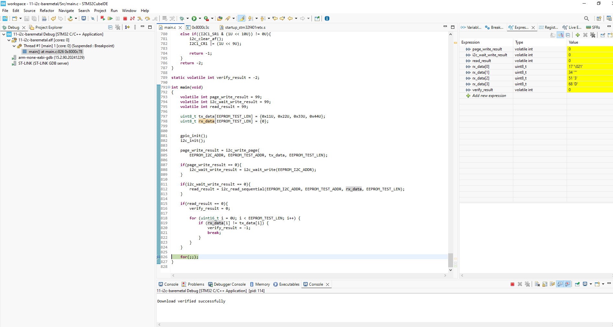

# STM32F401RE I2C1 Bare-Metal AT24C256 EEPROM

## Overview

This milestone uses direct I2C1 register access on the NUCLEO-F401RE to perform AT24C256 page write, ACK polling, sequential read, and byte-wise verification without STM32 HAL or LL I2C APIs.

The archive preserves the original project and hardware-tested main.c from C:/STM32/workspace/11-i2c-baremetal. The I2C implementation and existing unused functions are unchanged. The Debug screenshot comes from the user's original conversation attachment.

## Hardware

| NUCLEO-F401RE | AT24C256 |
|---|---|
| PB8 / I2C1 SCL / AF4 | SCL |
| PB9 / I2C1 SDA / AF4 | SDA |
| 3.3V | VCC |
| GND | GND |

The program uses the **7-bit slave address 0x50**. It shifts this address left by one bit and adds the R/W bit for transmission. A0/A1/A2 should be low to select this address, and WP should be low to allow writes.

SCL and SDA are configured as open-drain with MCU internal pull-ups disabled. The module or external resistors must pull both lines up to 3.3V. The supplied evidence does not record the actual pull-up resistance or WP/A0–A2 wiring; check these before reproducing the test.

With the assumed reset clock configuration of PCLK1 = 16 MHz:

```text
I2C1_CR2.FREQ = 16, I2C1_CCR = 80, I2C1_TRISE = 17
SCL = PCLK1 / (2 * CCR) = 16 MHz / 160 = 100 kHz
```

100 kHz is calculated from the clock assumption and register configuration, not a measured waveform frequency.

## Control flow

```text
Enable GPIOB and I2C1 clocks -> PB8/PB9 alternate function AF4
       |
Configure open-drain pins -> configure I2C1 timing -> enable I2C1
       |
Page write 0x11, 0x22, 0x33, 0x44 at EEPROM address 0x2400
       |
ACK polling -> wait until EEPROM acknowledges its write address
       |
Set EEPROM memory address -> repeated START -> sequential read 4 bytes
       |
Compare each received byte -> store verify_result -> empty infinite loop
```

Each step runs only if the preceding operation succeeds. Operation results retain their initial value of 99 if skipped; verify_result starts at -2.

## Register-level implementation

| Register | Purpose |
|---|---|
| `RCC_AHB1ENR` / `RCC_APB1ENR` | Enable GPIOB and I2C1 clocks |
| `GPIOB_MODER` / `GPIOB_AFRH` | Route PB8/PB9 to I2C1 using AF4 |
| `GPIOB_OTYPER` / `GPIOB_PUPDR` | Configure open-drain outputs with internal pull-ups disabled |
| `I2C1_CR2` / `I2C1_CCR` / `I2C1_TRISE` | Configure timing for the assumed 16 MHz peripheral clock |
| `I2C1_CR1` | Enable I2C1 and control START, STOP, ACK, and POS |
| `I2C1_SR1` / `I2C1_SR2` | Poll transfer status, clear ADDR by the read sequence, and handle acknowledge failure |
| `I2C1_DR` | Transfer slave address, 16-bit EEPROM memory address, and payload bytes |
| `I2C1_OAR1` | Set the required bit 14 during initialization |

`i2c_write_page()` checks the buffer, length, capacity, and page boundary before sending the memory address and payload. `i2c_wait_write()` retries the slave write address until the EEPROM acknowledges or the retry/timeout limit is reached. `i2c_read_sequential()` uses a repeated START and handles one-byte, two-byte, and longer reads separately. Main compares all four received bytes and exposes `verify_result` as a static volatile variable for debugger inspection.

## Debug verification

The user verified the program on physical hardware using STM32CubeIDE and ST-Link. The supplied Debug screenshot shows:

| Observation | Result |
|---|---|
| page_write_result | 0 |
| i2c_wait_write_result | 0 |
| read_result | 0 |
| verify_result | 0 |
| rx_data[0..3] | 17, 34, 51, 68 (0x11, 0x22, 0x33, 0x44) |



The user reported a build with **0 errors and 4 warnings**: the FPU initialization diagnostic and three unused functions (i2c_write_byte, i2c_read_byte, and i2c_probe). Archival did not repeat the hardware test. The screenshot is Debug evidence, not a build log. A successful integer-only test does not establish that the FPU has been initialized.

## Project structure

```text
11-i2c-baremetal/
|-- .project / .cproject       # STM32CubeIDE project metadata
|-- .settings/                # Portable Eclipse/CubeIDE settings
|-- Inc/                      # Reserved include directory (may be empty)
|-- Src/
|   |-- main.c                # I2C1 initialization and EEPROM verification
|   |-- syscalls.c
|   `-- sysmem.c
|-- Startup/
|   `-- startup_stm32f401retx.s
|-- STM32F401RETX_FLASH.ld
|-- STM32F401RETX_RAM.ld
|-- docs/
|   `-- debug-success.png     # Hardware verification screenshot
`-- README.md
```

Source, startup, linker scripts, and portable project settings are preserved from `C:/STM32/workspace/11-i2c-baremetal`. Generated Debug/Release directories, firmware images, local launch files, workspace metadata, and SFR view preferences are excluded from version control.

## Build and test

1. In STM32CubeIDE, select File > Import > Existing Projects into Workspace.
2. Select this directory and build the Debug configuration. Use a separate workspace if a project with the same name already exists.
3. Connect the hardware as described above and start Debug.
4. Set a breakpoint at the final for(;;) in main and inspect the variables listed in the verification table.

Every reset and execution rewrites the four bytes starting at EEPROM address `0x2400`.

### Archive verification

The copied source and project files were compared against the local original using file hashes, with no differences. No archive rebuild or additional hardware test was performed during this archival step. The reported 0 errors and 4 warnings belong to the user-tested original build.

## Known limitations

- Page write accepts 1–64 bytes, rejects writes crossing a 64-byte page boundary, and checks the 32 KiB capacity boundary. Automatic page splitting is not implemented.
- Sequential read includes separate paths for one byte, two bytes, and longer reads. The current hardware evidence covers only the four-byte test; other lengths and capacity boundaries remain unverified.
- Transfers use blocking polling and loop-count timeouts rather than elapsed milliseconds. ACK polling has a retry limit.
- Error-code meanings depend on the function and context; not every -1 or -2 indicates the same failure.
- Bus-stuck recovery, arbitration loss, bus errors, and state restoration after every timeout are not comprehensively handled. Fault injection has not been tested.
- Timing assumes PCLK1 = 16 MHz and must be reviewed if the clock configuration changes.
- Power-cycle retention, full-capacity transfers, endurance, and interrupt/DMA operation have not been verified.
- The hardware-tested implementation and four existing warnings are preserved. Future improvements should be separate changes followed by hardware regression testing.

## What I learned

- I2C uses open-drain SCL/SDA lines and requires pull-ups.
- The 7-bit slave address and the EEPROM's 16-bit memory address serve different purposes.
- Page writes must stay within the EEPROM page boundary.
- ACK polling detects completion of the EEPROM's internal write cycle.
- A repeated START switches from setting the memory address to reading data.
- STM32F4 receive handling requires different ACK/POS/STOP sequences for different transfer lengths.
- Successful transfer return codes and byte-wise data comparison provide complementary verification.
